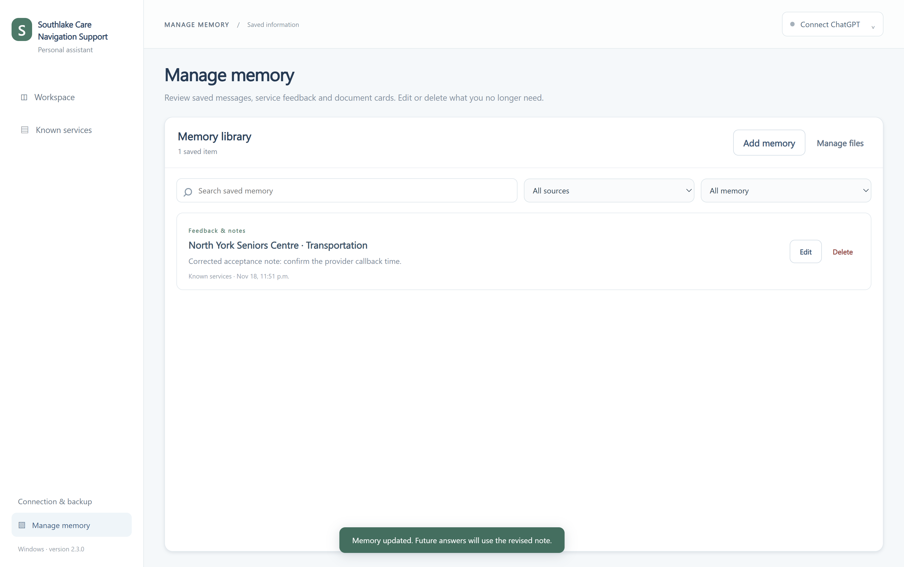

# Southlake Care Navigation Support

A Windows prototype that helps navigators turn spreadsheets and documents into searchable **memory cards**, ask questions in everyday language, and keep useful notes for future conversations.

**Status:** version 2.3.0 prototype. The Windows document readers and saved-card workflow have been tested. The installer is unsigned; real recipient ChatGPT access and Southlake deployment approval remain checks before routine field use.

The app, Windows shortcut and installer are named **Southlake Care Navigation Support**. Version 2.3 retains the previous Windows data location and installation identity so existing cards, notes and account connections remain available after updating. Close the previous version before running the new installer.

## Download and start

### [Download the complete handoff package](https://github.com/victor221218/southlake-care-navigation-support/releases/download/v2.3.0/Southlake-Care-Navigation-Support-Handoff-2.3.0.zip)

Everything needed to review the prototype in one download: the Windows installer, editable source files, user and developer guides, and the verification report.

| What you need | Open this |
| --- | --- |
| **Install and try the app** | [Windows installer](https://github.com/victor221218/southlake-care-navigation-support/releases/download/v2.3.0/Southlake-Care-Navigation-Support-Setup-2.3.0.exe) |
| **Quick-start guide** | [Download the quick-start guide](https://github.com/victor221218/southlake-care-navigation-support/releases/download/v2.3.0/Windows-Quick-Start.html) or [read the full guide here](START-HERE.md) |
| **Download all deliverables** | [Complete handoff ZIP](https://github.com/victor221218/southlake-care-navigation-support/releases/download/v2.3.0/Southlake-Care-Navigation-Support-Handoff-2.3.0.zip) |
| **Read or edit the code** | Browse the folders above; [start with the source map below](#source-code-map) |
| **Build or maintain the app** | [Windows development instructions](WINDOWS-DEVELOPMENT.md) |
| **Review test evidence and remaining checks** | [Release page and verification files](https://github.com/victor221218/southlake-care-navigation-support/releases/tag/v2.3.0) |

The public release can be downloaded without a GitHub account. Opening the installer is different from downloading source code: Use the installer to run the app or the source files for development.

## What the app and ChatGPT each do

**Southlake Care Navigation Support** is the Windows application. It imports files, creates source cards, stores personal notes, searches saved information, and manages backups.

**ChatGPT** supplies the AI that helps interpret questions and information, summarize records, and compare details. The app provides relevant saved text to the AI when you ask a question.

The current deliverable is a Windows app. To connect it to ChatGPT, open the app and choose **Continue with ChatGPT**. There is no separate plugin to install inside ChatGPT for this version, and no coding is needed to use the finished installer.


## Known services are ready on first launch

The app opens in **Workspace**, with a full-width chat and document upload beside Speak. Messages save automatically; there is no Keep this message checkbox. New conversation clears the chat while saved memory remains available.

Choose **Known services** to browse the 27 researched pathways as full-width horizontal rows. Category filtering and search appear above the directory; the assistant opens in a floating panel on the right. Open View details for contact details, access requirements, source links and research dates, or choose Ask assistant beneath View details to open the floating chat with that provider selected. A named person appears only when listed in the public source. Confirm eligibility, boundaries, costs and current capacity before referring.

**Manage memory**, at the bottom of the sidebar, contains saved messages, personal notes, imported document cards and feedback attached to service/document cards. Search or filter the list, edit a message or note, or delete an item. Public starting service cards remain in Known services when personal feedback is deleted. Imported source text stays intact; use Add correction to attach a correction or import a revised source. Completed memory edits/deletions clear the assistant's earlier context so subsequent answers retrieve the current records.


Choose the right-side chat button or Ask assistant to open a nonblocking side panel. Minimize it with × or Escape to browse the whole directory again. Open Workspace continues the same conversation in the full chat. Drafts, the selected service and saved memory are retained.




## The workflow

| Step | What happens |
| --- | --- |
| **1. Install** | Open `Southlake-Care-Navigation-Support-Setup-2.3.0.exe`, choose Install, then Finish. Later, open Southlake Care Navigation Support from the desktop or Start menu. |
| **2. Connect** | Choose Continue with ChatGPT. Sign in on OpenAI's page using your own ChatGPT account and review the requested permissions. Return to the app. |
| **3. Add a document** | Choose Add a document beside Speak at the bottom of the chat, select a file, review its preview and warnings, then Save cards. |
| **4. Ask a question** | Type a question, or Speak, Stop listening, review the transcript, and Send. Answers are text, with clickable source cards where relevant. |
| **5. Keep useful information** | Messages save automatically. Open Manage memory to edit/delete them. Questions about a selected card save on that card; other messages become personal memory cards. |
| **6. Maintain and hand over** | Review the source and test report, verify the intended account/data flow, then continue development and approved deployment. |

### Example

Import a service spreadsheet, then ask:

> Which entries cover North York, and what contact details are listed? Show the source cards.

Choose a card to see the original fields, worksheet/row or page reference, any contact details and links supplied by the document, and your dated notes. The app does not invent a contact person when the source only lists a phone number.

## How memory works

- Imported information is stored as cards separately from the chat.
- **New conversation** clears the chat and selected card; it keeps saved cards and notes.
- Messages save automatically when sent. Use **Manage memory** to edit or delete them; retrying an AI request does not create another saved message.
- With a selected card, messages become notes on that card. Otherwise, they become personal message cards.
- Card notes save automatically when you pause. They can be edited or deleted using the controls on that card.
- Revised spreadsheets can update matching cards using unique IDs or names, keeping attached notes when rows move. Ambiguous matches require a separate version. Previous rows remain accessible through Manage files.
- Different ChatGPT connections use separate local records. Starter cards saved before sign-in can be explicitly copied into the active account using Connection & backup.
- Save a private backup to move extracted cards and notes to another computer. Original files and credentials are not included in those backups.

The assistant draws on more information as you save it. This is persistent retrieval from your records, not training a new AI model. The app cannot read your existing ChatGPT conversations or ChatGPT Memory.

**GitHub hosts the application code and downloads. It does not host or synchronize users' personal documents, cards, memory or credentials.**

## Supported computers and documents

- **Windows 10 version 2004 or later / Windows 11**, 64-bit Intel or AMD.
- **Excel `.xlsx`, CSV, TSV, Word `.docx`, searchable PDF, TXT and Markdown.**
- Up to 20 MB per file, 5,000 extracted cards, 100 table columns, or 300 PDF pages. Split larger documents.
- Older `.xls` and `.doc` files need conversion first. Scan-only PDFs need OCR before import. Images and embedded objects are not imported.
- Excel formulas use their saved cached results and are not recalculated. Calculations use imported numeric values and report matched/excluded rows. PDF text is not assumed to be a structured spreadsheet.
- English speech input is bundled. Hive does not read answers aloud.
- The **27 preloaded Known services cards** contain public provider research and dated source links. Capacity and eligibility must be confirmed with the provider. No success rates or user feedback are seeded. The optional sample and test fixtures are fictional and kept separate.

## Which AI model does the app use?

The app calls OpenAI’s hosted models through its Sign in with ChatGPT connection. It requests the models allowed for the connected account, initially prefers a model whose identifier includes `mini` or `instant`, and otherwise uses the first available model. **The active model is shown under Ask your assistant** after selection or the first AI request. Use **Connection & backup → Choose an available AI model** to inspect or change it. The model choice is retained for the current account session and resets on reconnect/account switching. It does not automatically match a model selected in a separate ChatGPT chat. No separate local LLM is bundled. The bundled English speech model converts voice to text only.

## ChatGPT account requirements

The prototype implements OpenAI's published **Sign in with ChatGPT** connection. Current documentation describes eligible **ChatGPT Plus and Pro** accounts for this kind of plan-powered AI access; Pro is not specifically required. A Free account is not documented as supporting this AI connection. A subscription alone does not establish that the app/workspace is admitted: verify the real connection before purchasing a plan for the pilot.

Document import, cards, search, notes and backups work without a paid ChatGPT connection. AI answers require internet and a permitted account/app connection. There is no silent switch to separately billed API usage, and no shared sponsor token or API key is included.

Official references: [Sign in with ChatGPT](https://developers.openai.com/siwc/quickstart) and [integration overview](https://developers.openai.com/cookbook/articles/sign-in-with-chatgpt).

## Files in the complete handoff ZIP

Extract the ZIP first, then open **START-HERE.html** inside `Southlake-Care-Navigation-Support-Windows-2.3`.

| File or folder | What it is for |
| --- | --- |
| `START-HERE.html` | Links to the installer, guides and source overview within the extracted package |
| `Southlake-Care-Navigation-Support-Setup-2.3.0.exe` | The normal per-user Windows installer; includes the app runtime, document readers and English speech model |
| `source/` | The original editable source files, tests, dependency versions, build scripts and required source assets |
| `documentation/Windows-Quick-Start.html` | Quick-start instructions |
| `documentation/Full-Guide.md` | Detailed usage, file limits, memory and backup instructions |
| `documentation/Administrator-Handoff.md` | Maintenance/distribution notes and remaining rollout checks |
| `Verification.json` | The test and installer-verification summary |
| `HANDOFF-MANIFEST.json` | File inventory and integrity hashes |
| `SHA256.txt` | SHA-256 checksums for the package's contents |

## Source code map

These files are for developers. End users do not need to open or run them.

| File or folder | What it does |
| --- | --- |
| `src/document-main.mjs` | Current app entry point: Windows window, file dialogs, local workspace boundaries and UI requests |
| `src/documents/parse.mjs`, `worker.mjs`, `importer.mjs` | Background document reading, import preview, limits and saving originals |
| `src/documents/services.mjs` | Preloaded public service cards, dated contact/source checks and repeat-safe initialization |
| `src/app-identity.mjs` | Current app name and preserved Windows data location |
| `src/documents/store.mjs` | Persistent source cards, comments, searches, spreadsheet calculations and backup/restore |
| `src/documents/assistant.mjs` | AI conversation, source lookup and calculation tools, kept messages and error handling |
| `src/auth.mjs` | ChatGPT sign-in, verified account identity and protected credential handling |
| `src/responses.mjs` | Streaming AI text/tool responses and confirmed completion handling |
| `src/database.mjs`, `drizzle/` | Local SQLite database persistence and schema migrations |
| `ui/documents.mjs`, `ui/documents.css` | Known services and personal workspace layout, card details, notes and conversation controls |
| `ui/voice.mjs`, `scripts/voice-assets.mjs` | English speech input and bundled speech worker |
| `assets/` | English voice model, sample/check files, icons and third-party notices |
| `package.json`, `pnpm-lock.yaml`, `pnpm-workspace.yaml` | Dependency versions and development commands |
| `scripts/build.mjs`, `scripts/package.mjs` | Compile and package the application resources |
| `scripts/prepare-windows.py`, `scripts/windows-installer.iss` | Stage the Windows runtime and create the installer |
| `tests/`, `scripts/prepare-document-smoke.mjs` | Automated checks and the isolated native Windows acceptance harness |
| `WINDOWS-DEVELOPMENT.md` | Developer prerequisites, runtime configuration, build steps and native test instructions |
| `START-HERE.md`, `SHARING.md`, `RELEASE-NOTES.md` | User, administrator and release documentation |

The active version 2.3 build uses the **document** entry points listed above. Earlier service-navigation modules and Mac packaging experiments remain as historical source. They are identified in BUILDING.md and are not the active Windows workflow.

## Build and run from source

Developers need Node.js 24 and pnpm 11.25.0. From the project directory:

```powershell
pnpm install --frozen-lockfile --node-linker=hoisted
pnpm build
pnpm test
pnpm start
```

Build before testing because the document tests execute the built background reader. Creating a distributable installer additionally needs Python, the matching official Windows Electron runtime and Inno Setup. Follow [WINDOWS-DEVELOPMENT.md](WINDOWS-DEVELOPMENT.md) for the exact configuration and commands.

The finished installer does not require these developer tools.

## What has been checked

- **81 automated checks passed**, including parsing, persistence, account separation, spreadsheet updates, backups, comment corrections, transaction rollback, simulated OAuth/AI behavior and existing regressions.
- **Native Windows checks passed** for the default full-width chat, full-page services with a floating assistant, automatic message saving, memory editing/deletion, 27 preloaded services, category/search controls, document-upload placement, service-note persistence, bundled Excel, Word and PDF readers, import preview/save, card-note autosave, selected-card feedback, search, starting a new conversation, reopening the app, and saving a pending note when the app closes.
- **77 extracted installer files matched** the prepared Windows application.
- Installer and handoff SHA-256 checksums are published in the release’s `SHA256.txt` and `Verification.json`.

### Remaining prototype checks

Real ChatGPT sign-in/eligibility/inference on the intended account, live microphone access on the recipient's computer, publisher signing and Southlake deployment review remain to be completed. Local and simulated tests do not establish those live capabilities. This is a prototype handoff, not a claim of clinical deployment approval.

## Data and handoff notes

Personal records normally live in `%APPDATA%\Southlake Hive\documents.sqlite`, with copied originals in the `documents` subfolder. Credentials are separately protected by Windows storage. The app does not encrypt its document database or exported memory backups; protect the Windows account and backups accordingly.

AI questions send the question and relevant saved text to OpenAI. File import and local card/note operations do not need an AI request. Keep patient identifiers out of pilot tests, consistent with the project scope.

No real user records, imported private documents, passwords or account credentials are included in this repository or its handoff downloads. Third-party components retain their original licenses and notices; the Vosk notices are included under assets and the built app includes collected dependency notices.

Repository administration can be transferred to the receiving technical team as part of the handoff. The downloads and original source are available together through the release page.
