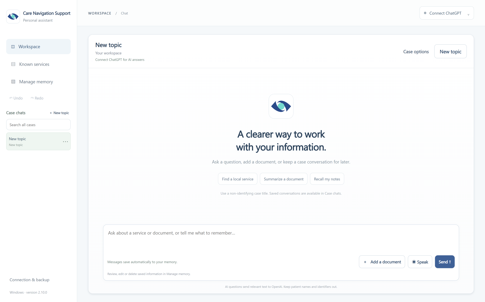
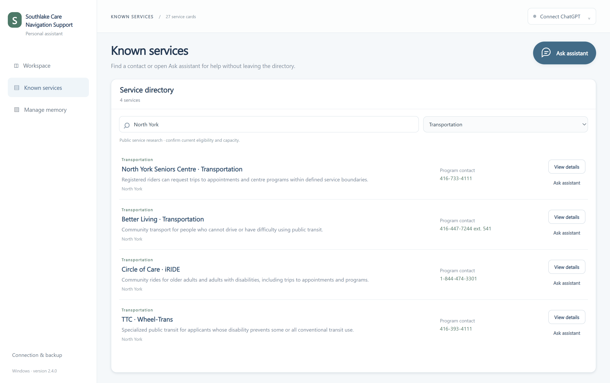
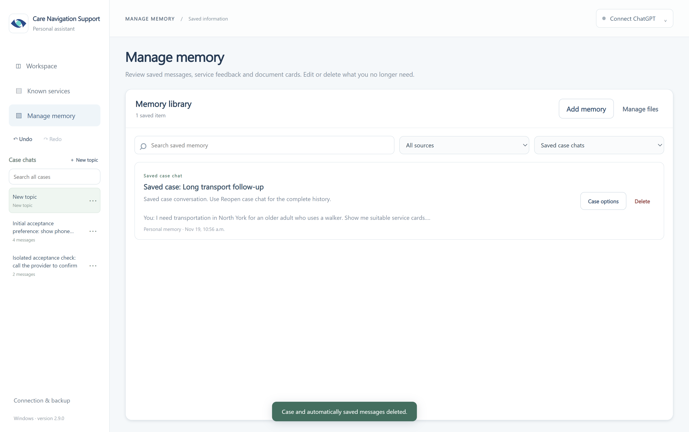
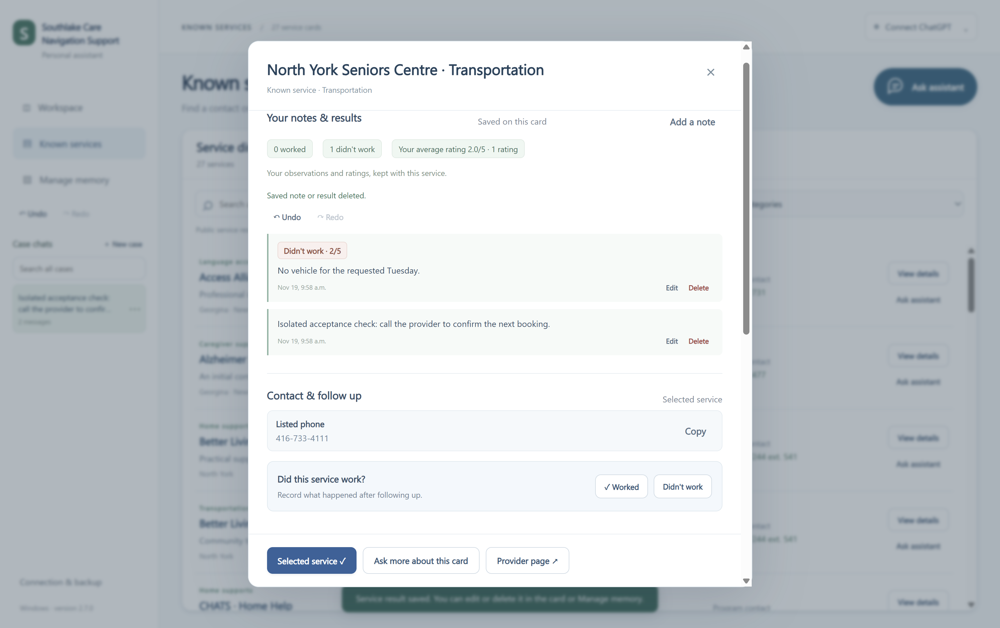
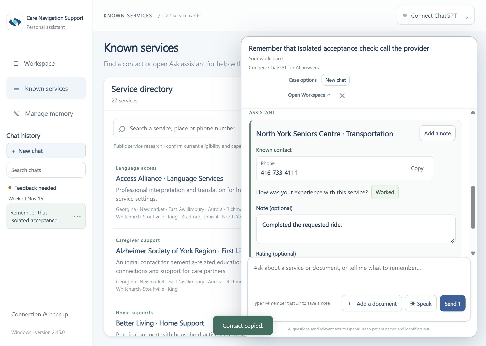

# Care Navigation Support

**[Download the latest handoff package](https://github.com/victor221218/southlake-care-navigation-support/releases/latest/download/Care-Navigation-Support-Handoff.zip)**

Extract the ZIP and open **START-HERE.html**. The package includes the current Windows installer, Mac test bundles, editable source, guides and verification results. You can download it while signed out of GitHub.

Care Navigation Support is a desktop prototype that turns spreadsheets and documents into searchable **memory cards**. Ask questions in everyday language and keep useful notes for future conversations.

## What the app and ChatGPT each do

**Care Navigation Support** is the Windows application. It imports files, creates source cards, stores personal notes, searches saved information, and manages backups.

**ChatGPT** supplies the AI that helps interpret questions and information, summarize records, and compare details. The app provides relevant saved text to the AI when you ask a question.

The current deliverable is a Windows app. To connect it to ChatGPT, open the app and choose **Continue with ChatGPT**. There is no separate plugin to install inside ChatGPT for this version, and no coding is needed to use the finished installer.



## Known services are ready on first launch

The app opens in **Workspace**, with a full-width chat and document upload beside Speak. Each discussion keeps its own messages and draft. Choose **New chat** to start a separate conversation.

Choose **Known services** to browse the 27 researched pathways as full-width horizontal rows. Category filtering and search appear above the directory; the assistant opens in a floating panel on the right. Open View details for contact details, access requirements, source links and research dates, or choose Ask assistant beneath View details to open the floating chat with that provider selected. The average of your saved ratings appears beside the program contact. Scores of 1–2 are red, 3 is yellow and 4–5 are green. A named person appears only when listed in the public source. Confirm eligibility, boundaries, costs and current capacity before referring.

**Manage memory**, directly beneath Known services, groups saved history by organization. Search an organization, service or note. Each group shows a short bullet preview with **Delete** beside the visible notes and results. Choose **Expand history** to see dated notes, results and saved conversations, with controls to open, edit or delete an item. Imported cards without an organization are grouped by file. Use **Add memory** to write a note and optionally name its organization.



Choose Ask assistant in the upper-right of the Known services heading, or beneath View details on a service row, to open the side panel. Minimize it with × or Escape to browse the whole directory again. Open Workspace continues the same conversation in the full chat. Drafts, the selected service and saved memory are retained.


### Compact choices and private case chats

Screenshots in this section use fictional practice documents and isolated feedback, not provider performance records.

Service recommendations show all returned cards together, without a separate written recommendation above or below them. Each card keeps its reason and important checks with the provider. Click a card for contact details, notes, ratings and provider links. There is no Show more choices or Read full response control. Long replies open at their first card; reading earlier messages keeps your place.


Choose **View details** to compare a provider’s coverage, access requirements and recorded history. Choose **Use this service** when you’re ready to follow up. The chat then shows the phone and email when listed, **Add a note**, and the choices **Worked**, **Didn’t work** and **Not yet**. Save the result with an optional note and rating.


**Chat history** puts **New chat** and search above three groups: **Feedback needed**, **No service selected**, and **Feedback recorded**. Each group lists its chats by week, with the latest activity first. A selected service stays under **Feedback needed** until its result is saved.

Choose **New chat** for a separate discussion. A detailed request gets a short title such as **Transportation in North York · Walker access**. Open **⋯ → Rename conversation** to edit the name or ask for a suggestion. Select a chat to return to its messages, selected service, and draft. Use **Earlier messages** to read older parts of the chat.


- **⋯ → Record feedback** jumps to the latest service that still needs a result, even if newer messages follow it.
- **⋯ → Add to memory library** keeps a useful conversation as one item. Find it under the linked organization or use **Manage memory → Saved conversations**. Open it and choose **Reopen conversation** to continue.
- **⋯ → Delete chat history** permanently discards a practice or inaccurate conversation and its older automatic entries.

After the last pending result and any open note are saved, a separate assistant message comes into view at the end of the chat and asks **What would you like to do next?** Choose **Keep in chat history**, **Add to memory library**, or **Delete chat and notes**. The last option asks for confirmation and removes the conversation and its linked notes, ratings and results. Review older standalone notes in **Manage memory**. For other conversations, open the chat's **⋯ → Finish conversation** from **Chat history**.



Use **Undo note** or **Undo result** directly beneath the follow-up card. The matching **Redo** control appears there after Undo. A rating change is labeled **Undo rating change**. Corrections affect the saved feedback linked to that card. The provider detail view also has its own correction controls. Text fields keep their normal typing shortcuts.

Services that match the search/category are ordered using the current user's saved experience. Lower average ratings appear later among matching options. Unrated services use a neutral position for ordering, without displaying a made-up rating; reported outcomes break ties. The actual average, sample count and notes remain visible. Eligibility and suitability still need confirmation. This is personal experience, not a provider-wide success measure.

### Use a service and record what happened

A service preview offers **Use this service**, **Ask more about this card**, and **Provider page**. **Use this service** opens the follow-up in chat, including when you select a service from the directory.

Your saved notes, reported results and optional ratings appear above Category and the provider facts. Known services also shows your latest note and a compact result summary above the category. These observations stay separate from the public provider information.

After following up, choose **Worked** or **Didn’t work** in the chat, add an optional rating and note, then choose **Save result**. Use **Not yet** to come back later.





Saved results can be edited or deleted on the card or in **Manage memory**. Summaries update after corrections, and results survive a new conversation, reopening the app and a memory backup/restore. Choose Add a note near the history heading for an ordinary note. Unsaved result drafts prompt before being discarded. Counts cover only explicit results recorded by the current user; they are not provider-wide success rates. Ratings are optional personal reports, not verified patient satisfaction.


The Ask assistant entry point is in the upper-right of the Known services heading, outside the service rows. Manage memory is directly beneath Known services in the sidebar.

## The workflow

| Step | What happens |
| --- | --- |
| **1. Install** | Open the Windows installer for your version, choose Install, then Finish. Later, open Care Navigation Support from the desktop or Start menu. |
| **2. Connect** | Choose Continue with ChatGPT. Sign in on OpenAI's page using your own ChatGPT account and review the requested permissions. Return to the app. |
| **3. Add a document** | Choose Add a document beside Speak at the bottom of the chat, select a file, review its preview and warnings, then Save cards. |
| **4. Ask a question** | Type a question, or Speak, Stop listening, review the transcript, and Send. Answers are text, with clickable source cards where relevant. |
| **5. Keep useful information** | Use **Add to memory library** to keep a whole conversation. Use **Remember that …** to save one note, or record a result from a service card. Search the organization in **Manage memory** and expand its history. |
| **6. Maintain and hand over** | Review the source and test report, verify the intended account/data flow, then continue development and approved deployment. |

### Example

Import a service spreadsheet, then ask:

> Which entries cover North York, and what contact details are listed? Show the source cards.

Choose a card to see the original fields, worksheet/row or page reference, any contact details and links supplied by the document, and your dated notes. The app does not invent a contact person when the source only lists a phone number.

## Mac test setup

In **Apple menu → About This Mac**, check whether the Mac has an Apple chip or Intel processor. Download the matching ZIP, open it in Finder and double-click **Install Care Navigation Support.command**. Follow the checklist in the extracted folder. The Mac packages include the same app files and starting services as this Windows release. Native launch, microphone access and ChatGPT sign-in still need a Mac test. The installer adds a local test signature. Routine distribution requires Apple Developer ID signing and notarization.

## Maintain the service inventory and outcomes

### Service Inventory worksheet

Use one row per program and location. The following column labels define the import format. Optional fields can be filled in as the provider confirms them.

| Information | Column labels |
| --- | --- |
| Identity and category | **Partner / organization**, **Program / clinic**, **Record Type**, **Service type**, **Service Subcategory**. An optional unique **Service ID** is useful if program names change. |
| What the program offers | **Population Served**, **Services offered**, **Eligibility**, **Delivery method**, **Service status** |
| Where it operates | **Geographic Coverage / Catchment**, **Service location** and municipality columns such as **Georgina**, **Newmarket** or **Aurora** marked **Yes** |
| Intake and referral | **Who can refer in?**, **How to refer in**, **Referral Requirements / Documents**, **Refers out to**, **Referral form / intake link** |
| Contacts and verification | **Main contact name**, **Main contact phone**, **Main contact email**, **Website**, **Information source**, **Last verified date**, **Internal Notes / Validation Required** |

1. In **Known services**, choose **Import services** and select the local inventory in Excel, CSV or TSV format. Review the proposed cards and the source rows. The app recognizes the column labels below grouped headings and keeps other populated columns with the service.
2. Use **Needs details** in Known services to find gaps in contact, coverage, intake, eligibility or verification. Open the card and choose **Edit details** to correct an entry you added. Update the workbook too if it remains your source.
3. When you receive changes, edit the full inventory workbook and keep its filename. Keep existing Service IDs or the same organization, program, service type, subcategory and location so the app can match rows. Import the revised workbook and select **Update saved inventory**. The app updates matching cards in place and keeps attached ratings and notes. Review included rows before saving. Rows omitted from an update are kept as previous rows.
4. For new providers, add a row to the workbook, choose **Add a service** in Known services, or ask “Can you add a service for me?” in chat. Enter any detail you have and choose **Save service**. An incomplete card appears under **Known services** with a **Needs details** label. Open **View details → Edit details** to fill in the rest. Keep working spreadsheets and case results in the local workspace.

The chat form shows **Category**, **Service or program**, **Service area** and **Phone**. Use **More details** for other fields. In Known services, choose **Remove** to hide a card from the directory and future recommendations. Use the **Removed services** filter to restore the card with its saved notes and ratings.

Known services shows **Services with recorded outcomes**, then your services and public services without recorded outcomes. A note alone leaves the result open. Cards retain their **Own source** or **Public source** label.

### Navigation worksheet

Choose **Import services** for the local tracker. The outcome review uses **Date of Inquiry**, **Partner Agency** and **Outcome / Next Steps**. Check the row in Excel, select its service card, and confirm **Worked** or **Didn’t work**. Leave pending, referral-only and closure-only rows unchecked. Add a missing program to Known services before importing its result. The app saves the confirmed outcome and source row in your workspace. It skips case identifiers, client contact fields, discussion text and storytelling when it reads the tracker.

To add more outcomes, append rows to the same tracker and reimport. Keep earlier row numbers and inquiry dates steady so previously recorded rows can be recognized. Correct previously imported feedback on the service card or in **Manage memory**.

### Live demo with a fictional service

Use **Add a service** to create two practice cards for caregiver support in Aurora, such as Example Community Respite and Example Caregiver Desk.

1. Ask **Find caregiver support in Aurora. Show ranked service cards.**
2. Name one of your fictional practice services and say **We tried Example Community Respite and it did not work. Rating 1 out of 5.** Use its exact name or choose the card first and say **It didn’t work. 1/5.** The app logs a clear report and asks you to choose if the provider name is unclear.
3. Start a **New chat** and repeat the first request. When options are equally relevant, low ratings rank below unrated or better-rated services. Without a rating, a recorded unsuccessful result moves that service below equally relevant untried choices.
4. Ask **How did you rank the options?** To see one card's explanation, open **View details**, then **Why this rank**. The explanation uses matches to the request, your rating sample and your recorded outcomes. The demo works with locally saved cards.

## How memory works

- Imported information is stored as cards separately from the chat.
- **New chat** starts another chat with its own selected card and draft. Earlier cases stay in the sidebar.
- Ordinary chat turns stay together in Chat history. Type **Remember that …** to save a single note. When a card is selected, the note goes on that card.
- With a selected card, messages become notes on that card. Otherwise, they become personal message cards.
- Card notes save automatically when you pause. They can be edited or deleted using the controls on that card.
- Revised spreadsheets can update matching cards using unique IDs or names, keeping attached notes when rows move. Ambiguous matches require a separate version. Previous rows remain accessible through Manage files.
- Different ChatGPT connections use separate local records. Starter cards saved before sign-in can be explicitly copied into the active account using Connection & backup.
- Save a private backup to move extracted cards and notes to another computer. Original files and credentials are not included in those backups.

The assistant draws on more information as you save it. This is persistent retrieval from your records, not training a new AI model. The app cannot read your existing ChatGPT conversations or ChatGPT Memory.

**GitHub hosts the application code and downloads. It does not host or synchronize users' personal documents, cards, memory or credentials.**

## Supported computers and documents

- **Windows 10 version 2004 or later / Windows 11**, 64-bit Intel or AMD.
- **Excel `.xlsx`, CSV, TSV, Word `.docx`, searchable PDF, TXT and Markdown.**
- Up to 20 MB per file, 5,000 extracted cards, 100 table columns, or 300 PDF pages. Split larger documents.
- Older `.xls` and `.doc` files need conversion first. Scan-only PDFs need OCR before import. Images and embedded objects are not imported.
- Excel formulas use their saved cached results and are not recalculated. Calculations use imported numeric values and report matched/excluded rows. PDF text is not assumed to be a structured spreadsheet.
- English speech input is bundled. Hive does not read answers aloud.
- The **27 preloaded Known services cards** contain public provider research and dated source links. Capacity and eligibility must be confirmed with the provider. No success rates or user feedback are seeded. The optional sample and test fixtures are fictional and kept separate.

## Which AI model does the app use?

The app calls OpenAI’s hosted models through its Sign in with ChatGPT connection. It requests the models allowed for the connected account, initially prefers a model whose identifier includes `mini` or `instant`, and otherwise uses the first available model. **The active model is shown under Ask your assistant** after selection or the first AI request. Use **Connection & backup → Choose an available AI model** to inspect or change it. The model choice is retained for the current account session and resets on reconnect/account switching. It does not automatically match a model selected in a separate ChatGPT chat. No separate local LLM is bundled. The bundled English speech model converts voice to text only.

## ChatGPT account requirements

The prototype implements OpenAI's published **Sign in with ChatGPT** connection. Current documentation describes eligible **ChatGPT Plus and Pro** accounts for this kind of plan-powered AI access; Pro is not specifically required. A Free account is not documented as supporting this AI connection. A subscription alone does not establish that the app/workspace is admitted: verify the real connection before purchasing a plan for the pilot.

Document import, cards, search, notes and backups work without a paid ChatGPT connection. AI answers require internet and a permitted account/app connection. There is no silent switch to separately billed API usage, and no shared sponsor token or API key is included.

Official references: [Sign in with ChatGPT](https://developers.openai.com/siwc/quickstart) and [integration overview](https://developers.openai.com/cookbook/articles/sign-in-with-chatgpt).

## Files in the complete handoff ZIP

Extract the ZIP and open **START-HERE.html** from the extracted folder.

| File or folder | What it is for |
| --- | --- |
| `START-HERE.html` | Links to the installer, guides and source overview within the extracted package |
| `Care-Navigation-Support-Setup-<version>.exe` | The per-user Windows installer with the app runtime, document readers and English speech model |
| `Mac/` | Apple Silicon and Intel test bundles with package verification results |
| `source/` | The original editable source files, tests, dependency versions, build scripts and required source assets |
| `source/START-HERE.md` | Detailed usage, file limits, memory and backup instructions |
| `source/SHARING.md` | Distribution notes and remaining rollout checks |
| `Verification.json` | The test and installer-verification summary |
| `SHA256.txt` | SHA-256 checksums for the package's contents |

## Source code map

These files are for developers. End users do not need to open or run them.

| File or folder | What it does |
| --- | --- |
| `src/document-main.mjs` | Current app entry point: Windows window, file dialogs, local workspace boundaries and UI requests |
| `src/documents/parse.mjs`, `worker.mjs`, `importer.mjs` | Background document reading, import preview, limits and saving originals |
| `src/documents/services.mjs` | Preloaded public service cards, dated contact/source checks and repeat-safe initialization |
| `src/app-identity.mjs` | Current app name and preserved Windows data location |
| `src/documents/store.mjs` | Persistent source cards, comments, searches, spreadsheet calculations and backup/restore |
| `src/documents/case-followups.mjs`, `topic.mjs` | In-chat service selection, saved feedback drafts and short topic titles |
| `src/documents/assistant.mjs` | AI conversation, source lookup and calculation tools, kept messages and error handling |
| `src/auth.mjs` | ChatGPT sign-in, verified account identity and protected credential handling |
| `src/responses.mjs` | Streaming AI text/tool responses and confirmed completion handling |
| `src/database.mjs`, `drizzle/` | Local SQLite database persistence and schema migrations |
| `ui/documents.mjs`, `ui/documents.css` | Known services and personal workspace layout, card details, notes and conversation controls |
| `ui/voice.mjs`, `scripts/voice-assets.mjs` | English speech input and bundled speech worker |
| `assets/` | English voice model, sample/check files, supplied logo artwork, Windows icons and third-party notices |
| `package.json`, `pnpm-lock.yaml`, `pnpm-workspace.yaml` | Dependency versions and development commands |
| `scripts/build.mjs`, `scripts/package.mjs` | Compile and package the application resources |
| `scripts/prepare-windows.py`, `scripts/windows-installer.iss` | Stage the Windows runtime and create the installer |
| `tests/`, `scripts/prepare-document-smoke.mjs` | Automated checks and the isolated native Windows acceptance harness |
| `WINDOWS-DEVELOPMENT.md` | Developer prerequisites, runtime configuration, build steps and native test instructions |
| `START-HERE.md`, `SHARING.md`, `RELEASE-NOTES.md` | User, administrator and release documentation |

The current app uses the **document** entry points listed above. BUILDING.md describes earlier service-navigation modules retained in the source.

## Build and run from source

Developers need Node.js 24 and pnpm 11.25.0. From the project directory:

```powershell
pnpm install --frozen-lockfile --node-linker=hoisted
pnpm build
pnpm test
pnpm start
```

Build before testing because the document tests execute the built background reader. Creating a distributable installer additionally needs Python, the matching official Windows Electron runtime and Inno Setup. Follow [WINDOWS-DEVELOPMENT.md](WINDOWS-DEVELOPMENT.md) for the exact configuration and commands.

The finished installer does not require these developer tools.

## What has been checked

See **Verification.json** in the handoff for current automated and Windows acceptance results and installer verification. **SHA256.txt** lists checksums for the files in the package. The Mac test bundles have separate checks for their architecture and included application files.

### Remaining prototype checks

Real ChatGPT sign-in/eligibility/inference on the intended account, live microphone access on the recipient's computer, publisher signing and Southlake deployment review remain to be completed. Local and simulated tests do not establish those live capabilities. This is a prototype handoff, not a claim of clinical deployment approval.

## Data and handoff notes

Personal records normally live in `%APPDATA%\Southlake Hive\documents.sqlite`, with copied originals in the `documents` subfolder. Credentials are separately protected by Windows storage. The app does not encrypt its document database or exported memory backups; protect the Windows account and backups accordingly.

AI questions send the question and relevant saved text to OpenAI. File import and local card/note operations do not need an AI request. Keep patient identifiers out of pilot tests, consistent with the project scope.

No real user records, imported private documents, passwords or account credentials are included in this repository or its handoff downloads. Third-party components retain their original licenses and notices; the Vosk notices are included under assets and the built app includes collected dependency notices.

Repository administration can be transferred to the receiving technical team as part of the handoff. The downloads and original source are available together through the release page.
